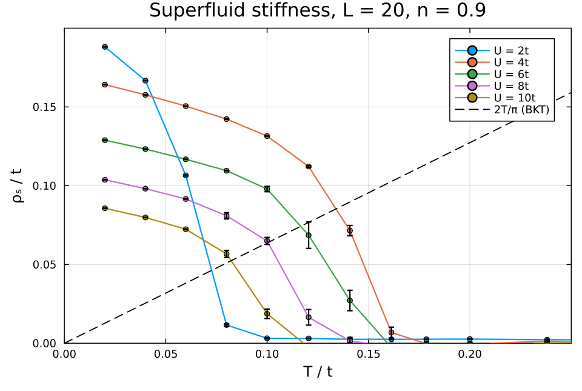

# Habburd_MC_V7

Monte-Carlo mean-field (MCMF) simulation of the two-dimensional **attractive
Hubbard model** with disorder: superconductivity, its phase fluctuations, and
transport, at finite temperature, on lattices up to L ≈ 32. Written in Julia.

This code was written for the M.Sc. thesis of Yaniv Zelikovich at the Racah
Institute of Physics, The Hebrew University of Jerusalem, Israel, under the
supervision of Prof. Dror Orgad:

> Y. Zelikovich, *Probing Strange Metal Signatures in an Interaction-Disordered
> Hubbard Model via Monte Carlo Mean Field Approximation*, M.Sc. thesis, The Hebrew
> University of Jerusalem (2026). [PDF](docs/thesis/Zelikovich_MSc_thesis_2026.pdf)

The simulations ran on the Curie and Landau clusters of the Fritz Haber Research
Center for Molecular Dynamics, The Hebrew University of Jerusalem, Israel.

**Contact:** Yaniv Zelikovich, zelikovich.yaniv@gmail.com

**License:** MIT ([LICENSE](LICENSE)). You may use, change and share the code,
keeping the copyright notice. If you use it in published work, please cite the
thesis above.

- [The physics](#the-physics) — model, method, observables, [an example result](#an-example-result)
- [Running a simulation](#running-a-simulation) — on your own computer
- [Many simulations](#many-simulations) — campaigns, means and error bars, the results database
- [Documentation](#documentation)
- [Layout](#layout)

---

## The physics

### Model

On an Lx × Ly square lattice with periodic boundary conditions,

$$
H = -t\sum_{\langle ij\rangle\sigma} e^{i\theta_{ij}}\, c^\dagger_{i\sigma}c_{j\sigma}
    \;-\;\sum_i (\mu - V_i)\, n_i \;-\;\sum_i U_i\, n_{i\uparrow}n_{i\downarrow},
\qquad U_i \ge 0 .
$$

- `t` hopping, `μ` chemical potential (tuned automatically to a target density `n`);
- `U_i` attraction, uniform (`U`) or site-dependent (U disorder);
- `V_i` on-site potential disorder, `V_i ~ Uniform[−V/2, V/2]`;
- `θ_ij` Peierls phases of an orbital magnetic field `B` (zero by default).

### Method: Monte-Carlo mean field

The interaction is decoupled with **static** (imaginary-time independent)
Hubbard–Stratonovich fields: a complex pairing field Δᵢ and, optionally, a real
density field φᵢ. A fraction `α` of Uᵢ goes into the pairing channel and a
fraction `β_φ` into the density channel (`α = 1, β_φ = 0` is the usual
pairing-only decoupling). For every field configuration the fermions are
non-interacting, so they are solved exactly by diagonalizing the 2N × 2N
Bogoliubov–de Gennes (BdG) matrix (N = Lx·Ly), with quasiparticle energies Eₙ.
Integrating them out gives the classical action

$$
S[\Delta,\phi] = -2\sum_{n=1}^{N}\ln\cosh\frac{\beta E_n}{2}
  + \beta\sum_i\left[\frac{|\Delta_i|^2}{\alpha U_i}
  + \frac{\phi_i^2}{2\beta_\phi U_i} - \cos(\mathbf Q\cdot\mathbf r_i)\,\phi_i\right],
$$

and the fields are sampled with weight e^{−S} by Metropolis Monte Carlo. One
**MC step** (sweep) is N single-site updates per field: propose Δᵢ → Δᵢ + δ (and
φᵢ → φᵢ + δ), recompute S, accept with probability min(1, e^{−ΔS}). The density
field couples as a local shift μ → μ + cos(Q·rᵢ) φᵢ; Q = (0,0) is a uniform
(Hartree) channel, Q = (π,π) a checkerboard. The thermal fluctuations of the
classical fields (amplitude and phase) are kept exactly; quantum (dynamical)
fluctuations are not.

### How ΔS is computed (`diag_method`)

| `diag_method` | Each proposed update | Cost per sweep |
|---|---|---|
| `"K0"` | full diagonalization of the 2N × 2N BdG matrix | ∝ N · (2N)³ |
| `"K0-TCA"` | **travelling cluster approximation**: diagonalize only a `TClustersize` × `TClustersize` cluster around the updated site | ∝ N · (2·TClustersize²)³ |

With K0-TCA the measurements still use the full lattice. If `TClustersize ≥ L`
the run falls back to `"K0"`. In the existing campaigns, L ≤ 14 ran with `"K0"`
and larger lattices with `"K0-TCA"` (`TClustersize` 8 or 10).

> **Pairing symmetry.** Only on-site **s-wave** pairing (`pairing_symmetry =
> "s-wave"`) is validated. The d-wave and mixed options (bond pairing fields
> Δ_dx, Δ_dy) exist but were never benchmarked against published results, and
> the normalization of the bond term is not settled; a run with them prints a
> warning.

`"exact"` and `"TCluster"` belong to an abandoned **supercell** method (the lattice
repeated `SC_L` × `SC_L` times, with a supercell wavevector K). It sampled
badly and many observables are not defined for it. Keep `SC_L = 1` and use
`"K0"` / `"K0-TCA"`; "K0" means diagonalizing only the K = 0 sector.

### Disorder and fields

| Parameter | What it adds |
|---|---|
| `V` | potential disorder Vᵢ ~ Uniform[−V/2, V/2] |
| `U_disorder` (+ `U_puddle_params`, `impurity`, `smooth_U`) | site-dependent Uᵢ; several models, see `make_U_params` in `MC_Hubburd.jl` |
| `mu_disorder`, `mu_disorder_f` | binary Uᵢ ∈ {0, U} on a fraction f of the sites, with or without the shift μᵢ = μ − Uᵢ/2 |
| `disorder_seed` | which disorder sample is drawn (independent of the MC seed) |
| `B`, `gauge_choice` | orbital magnetic field, in units of the flux through one plaquette (Peierls phases; the total flux is rounded to a multiple of 2π) |
| `alpha`, `beta_phi`, `Qx`, `Qy` | the density channel (see above) |

### Observables

Measured every `measuring_interval` sweeps (`make_measurement_K!`); means and
error bars are computed afterwards (`get_means`):

- **density** `n`; **pairing**: `Ps` = 2⟨DdD⟩ − ⟨n⟩ + 1 (pair structure
  factor, from the pair operator `DdD`), `Ps_l` and `Phase_Corr` (pair
  correlations vs distance), `S_Delta_Q0` = ⟨|mean Δ|²⟩ (structure factor of the
  pairing field);
- **superfluid stiffness** ρ_s (`stiffness`, `stiffness_q0`, …), from the kinetic
  energy `Kx` and the transverse current–current correlator Λ_xx(q);
- **transport**: optical conductivity σ(ω) at fixed broadenings δ, extrapolated
  to δ → 0 (`conductivity_regular_*_fixed[_extrap]`), DC conductivity and
  resistivity tensor, Drude weight (`drude_direct_*`, `drude_dc_*`);
- **spectra**: density of states `DOS`, local DOS `LDOS`;
- **susceptibilities** `chi_spin`, `chi_charge`;
- **fields**: mean Δ, its distribution (histograms), snapshots of the full field.

The BKT temperature follows from ρ_s(T_c) = 2T_c/π (`find_tc`, `find_tc_fit` in
`statistics.jl`).

### An example result



The superfluid stiffness of the clean 20 × 20 system at n = 0.9, for U = 2t to
10t, from the archived V7 data (`"K0-TCA"`, cluster size 8). ρ_s drops to zero
across the superconducting transition. Where it crosses the BKT line 2T/π gives the
Berezinskii–Kosterlitz–Thouless temperature T_c. T_c rises from U = 2t (≈ 0.07t) to
a maximum near U = 4t (≈ 0.13t) and falls again at larger U. This is the
BCS–BEC crossover: the low-temperature stiffness keeps decreasing as U grows.
[`examples/readme_stiffness_plot.jl`](examples/readme_stiffness_plot.jl) makes this
figure; it reads only `means_db`.

---

## Running a simulation

### Install

Julia ≥ 1.10. In the repository folder:

```bash
julia --project=. -e 'using Pkg; Pkg.instantiate()'
```

### One simulation

```bash
julia --project=. examples/run_one_simulation.jl
```

[`examples/run_one_simulation.jl`](examples/run_one_simulation.jl) runs a 4 × 4
lattice at U = 4, n = 0.875, β = 5 in about two minutes. It thermalizes as long as
the production runs (5000 sweeps, and 200 sweeps at each trial μ of the μ search)
but takes fewer measurements (2000), and prints the means:

```
converged mu = -0.3759   measurements = 2000
  n                =    0.87424 ± 0.00041   (τ = 6.0 measurements)
  S_Delta_Q0       =    0.95529 ± 0.07119   (τ = 17.9 measurements)
  Ps               =    2.40626 ± 0.08962   (τ = 18.5 measurements)
  stiffness        =    0.03904 ± 0.00386   (τ = 15.6 measurements)
  drude_direct_xx  =    0.71254 ± 0.04876   (τ = 17.7 measurements)
```

Another run (another Julia version or machine) gives values within a few error
bars of these.

It does exactly what one cluster job does:

1. **Parameters** go into `<folder>/sim.jld2` (a Dict; every key is explained in
   [docs/WORKFLOW.md, Appendix A](docs/WORKFLOW.md#appendix-a--parameters-of-one-simulation-simjld2)).
2. **`julia fh_run_n.jl --sim_path=<folder>`** runs the simulation
   (`running_simulation_wanted_occupation` in `occupation_convergence.jl`):
   - **μ search**: short runs at trial μ (starting from mean field) until
     |⟨n⟩ − `wanted_n`| < `n_tol`;
   - **thermalization**: `num_thermal` sweeps (the μ-search sweeps count);
   - **measurements**: `num_measure` of them, one every `measuring_interval` sweeps;
   - **saving** every 500 measurements or every hour, into `<folder>/seed_<s>/`:
     `results.jld2` (all measurements), `checkpoint.jld2` (the field
     configuration), `simulation_log.txt`. A run started again in the same
     folder **resumes** from the checkpoint.
3. **Means**: `load_results(<folder>/seed_<s>)` reads the run back, and
   `get_means(data)` returns, for every observable, its mean, error bar
   (autocorrelation-corrected), autocorrelation time τ and number of
   uncorrelated measurements. [docs/WORKFLOW.md §6](docs/WORKFLOW.md#6-means-and-error-bars-num_control)
   explains the statistics.

Directly in Julia, the same run is

```julia
include("occupation_convergence.jl")
data = running_simulation_wanted_occupation(
    4, 4, 1,               # Lx, Ly, SC_L
    4.0, 1.0, 0.0,         # U, t, V
    1, 0.875, 5.0, 0.0,    # MC seed, wanted_n, beta, B
    2000, 5000, 5,         # num_measure, num_thermal, measuring_interval
    collect(range(-5, 5, length=41)),   # w_list (DOS energies)
    "uniform", "uniform", "K0", "s-wave",   # guess, U_disorder, diag_method, pairing
    collect(range(0.1, 4, length=10)),  # w_conductivity_range
    0.0;                   # impurity
    savedata=false, directory=mktempdir(), n_tol=0.005,
    num_thermal_occ=200, num_measure_occ=100, measuring_interval_occ=5)
include("sim_num_control.jl"); means = get_means(data)
```

---

## Many simulations

A study is a **campaign**: a sweep over parameters (U, n, L, T, disorder
samples, …), one SLURM job per simulation. The pipeline:

1. a **submit driver** (`fh_pre_run_V.jl` is the template) writes one folder +
   `sim.jld2` per simulation and submits its job;
2. each job runs `fh_run_n.jl`;
3. **num_control** (`run_num_control_V.jl`) computes every seed's means, combines
   the MC seeds, and writes one small file per simulation into **`means_db`**;
4. you query `means_db`, from any computer:

```julia
include("means_db.jl")
c = get_curve(; obs=:stiffness, x=:beta, U=4.0, Lx=20, wanted_n=0.875, V=0.0)
plot(1 ./ c.x, c.value, yerr=c.error)
```

Disorder samples are separate simulations and are averaged at query time.

The raw data of the campaigns run so far (V7, and the V6 campaigns of the thesis)
is archived on a backup drive as small slim files plus both clusters' `means_db`;
one setting, `ENV["BACKUP_DRIVE"]`, points every query there
([docs/WORKFLOW.md §8](docs/WORKFLOW.md#8-the-backup-drive);
worked example: [`notebooks/read_archive.ipynb`](notebooks/read_archive.ipynb)).

## Documentation

| Document | Contents |
|---|---|
| [docs/WORKFLOW.md](docs/WORKFLOW.md) | campaigns step by step, the statistics, `means_db`, the archived data on the backup drive, extending the code, all parameters |
| [docs/FHRC_CLUSTERS.md](docs/FHRC_CLUSTERS.md) | running on the Fritz Haber Center clusters (Landau, Curie): setup, the storage rules, scratch-mode jobs, preemption, commands |
| [docs/thesis/Zelikovich_MSc_thesis_2026.pdf](docs/thesis/Zelikovich_MSc_thesis_2026.pdf) | the M.Sc. thesis: the physics, the method, and the results this code produced |
| [archive/README.md](archive/README.md) | superseded code |

Functions carry docstrings; in the Julia REPL, `?get_curve` shows one.

## Layout

| Group | Files |
|---|---|
| Engine | `MC_Hubburd.jl` (lattice, BdG, MC updates, measurements, saving), `statistics.jl`, `mf_kspace_density_channel.jl`, `dwave-kspaceMF.jl` |
| One simulation | `fh_run_n.jl`, `occupation_convergence.jl`, `examples/` |
| Means | `sim_num_control.jl` (`get_means`, seed averaging), `means_db.jl` (database + queries), `means_store.jl` (old V6 store) |
| Campaigns | `fh_pre_run_V.jl` (template), `fh_pre_run_mu_disorder.jl`, `fh_pre_run_tarat_rerun.jl`, `fh_pre_run_continue_bad.jl`, `fh_resubmit_campaign.jl`, `pre_run_num_control_V.jl`, `run_num_control_V.jl` |
| Cluster jobs | `cluster_config.jl`, `pre_pre_run.jl`, `slurm_job_mode.jl`, `slurm_memory.jl`, `scratch_job.sh`, `scratch_fix_paths.jl` |
| Archived data | `slim_results.jl` (writes `results_slim.jld2`: exact means + binned streams), `verify_slims.jl`, `drive_data.jl` (reads the backup drive) |
| Analysis helpers | `data_summery.jl`, `plotting_helpers.jl`, `plotting_helpers_unified.jl`, `disorder_p_helpers.jl`, `simulation_obs_inspection.jl`, `simulation_statistics_report.jl` |
| Tests | `tests/`, `tests_pre_run.jl` |
| Examples | `examples/run_one_simulation.jl`, `examples/readme_stiffness_plot.jl` (the figure above); notebook `notebooks/read_archive.ipynb` (queries, slims, V6 + V7 from the backup drive or the clusters) |

File names keep their historical spelling (`MC_Hubburd.jl`, `data_summery.jl`):
the job scripts of simulations already on disk refer to them.

Julia resolves `include(...)` relative to the including file: top-level scripts
use `include("MC_Hubburd.jl")`, files in `tests/` and `examples/` use
`joinpath(@__DIR__, "..", "X.jl")`.
